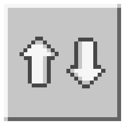

# xSorter

A simple Minecraft Bedrock addon that sorts chest items by category and name, merging stacks whenever possible.

## Usage

Sneak and hit a chest to sort its contents.

## License

This project is licensed under the GNU General Public License v3.0 (GPL-3.0). See [LICENSE](LICENSE) for details.